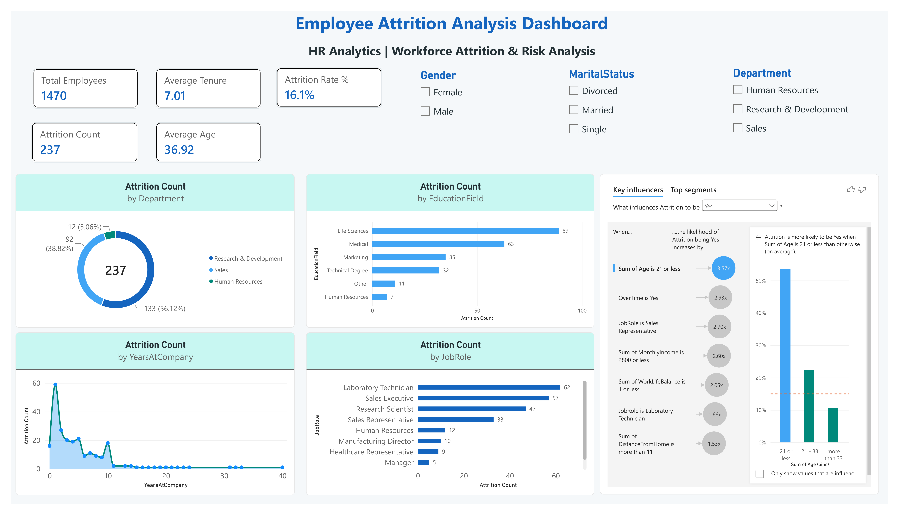
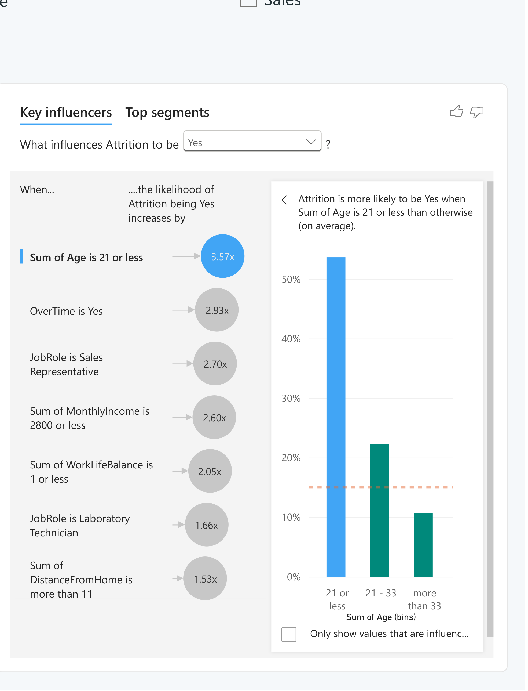

# 📊 HR Employee Attrition & Retention Analysis — Power BI

An interactive **Power BI HR Analytics Dashboard** designed to analyze employee attrition, identify high-risk employee groups, understand workforce trends, and explore factors associated with employee turnover.

---

## 📌 Project Overview

Employee attrition can increase recruitment costs, disrupt productivity, and create workforce instability.

This project uses the **IBM HR Analytics Employee Attrition & Performance dataset** to build an interactive dashboard that helps analyze:

- Overall employee attrition
- Department-wise attrition
- Education field patterns
- Job role attrition
- Employee tenure
- Demographic segments
- Factors associated with employee turnover

---

## 🎯 Project Objectives

- Quantify overall employee attrition
- Calculate and monitor the overall attrition rate
- Analyze attrition across departments and job roles
- Identify patterns across education fields
- Analyze attrition based on employee tenure
- Identify employee groups with higher attrition
- Explore potential attrition drivers using Power BI Key Influencers
- Support data-driven HR decision-making

---

## 📂 Dataset

**Dataset:** IBM HR Analytics Employee Attrition & Performance

**Source:** Kaggle

The dataset contains employee information covering demographics, job details, compensation, travel, satisfaction, and tenure.

### Key Attributes

- Age
- Gender
- Marital Status
- Education Field
- Department
- Job Role
- Job Level
- Business Travel
- Distance From Home
- Monthly Income
- Percent Salary Hike
- Years at Company
- Years Since Last Promotion
- Attrition

---

## 📊 Dashboard KPIs

| KPI | Value |
|---|---:|
| 👥 Total Employees | 1,470 |
| 🚪 Attrition Count | 237 |
| 📉 Attrition Rate | 16.1% |
| 🎂 Average Age | 36.92 |
| ⏳ Average Tenure | 7.01 Years |

---

## 📈 Dashboard Analysis

### 1. Attrition by Department

A donut chart showing employee attrition across:

- Research & Development
- Sales
- Human Resources

This helps identify which departments contribute most to overall attrition.

---

### 2. Attrition by Education Field

A bar chart comparing employee attrition across different education fields.

This helps identify education backgrounds associated with higher employee turnover.

---

### 3. Attrition by Years at Company

A line chart showing employee attrition across different tenure levels.

This helps identify periods during an employee's career where attrition is concentrated.

---

### 4. Attrition by Job Role

A bar chart showing attrition across different job roles.

This helps HR identify roles with higher employee turnover.

---

### 5. Key Influencers Analysis

Power BI's **Key Influencers** visual is used to explore factors associated with employee attrition.

**Analyze:**
- Attrition = Yes

**Explain By:**
- Age
- Distance From Home
- Job Role
- OverTime
- Monthly Income
- WorkLifeBalance

The visual provides an interactive way to explore potential factors associated with employee attrition.

> Key Influencers results represent statistical associations in the dataset and should not be interpreted as proof of causation.

---

## 🎛️ Interactive Filters

The dashboard includes slicers for:

- Gender
- Department
- Marital Status

Users can combine filters to analyze specific employee segments.

---

## 💡 Key Insights

The dashboard provides insights such as:

- **237 employees** are recorded as having left the organization.
- Overall employee attrition is approximately **16.1%**.
- **Research & Development** has the highest attrition count among the departments.
- Attrition varies across different job roles and education fields.
- Employee tenure provides useful insight into when turnover is concentrated.
- Key Influencers can be used to explore factors associated with employee attrition.

---

## 🔎 Business Questions Answered

The dashboard can help HR teams investigate:

- Which department has the highest attrition?
- Which education fields have higher attrition?
- Which job roles experience more employee turnover?
- At what tenure levels is attrition concentrated?
- Does overtime appear to be associated with higher attrition?
- Is WorkLifeBalance associated with employee attrition?
- How does attrition vary across demographic groups?
- Does employee satisfaction appear related to turnover?
- Which employee segments may require further HR investigation?

---

## 🎨 Dashboard Features

- Interactive KPI cards
- Department-wise attrition analysis
- Education field analysis
- Job role analysis
- Tenure trend analysis
- Key Influencers AI visual
- Interactive slicers
- Cross-filtering between visuals
- Clean and professional HR dashboard layout

---

## 🧹 Data Preparation

The dataset was prepared in Power BI before dashboard development.

### Data Quality

- Column quality was checked
- Data types were validated
- Missing and invalid values were checked
- Employee records were validated

### Data Transformation

- Created an `Attrition_Flag` for analysis
- Created age bands:
  - 18–25
  - 26–35
  - 36–45
  - 46+

Detailed transformation and calculation steps are documented in:

**[PROJECT_DOCUMENTATION.md](PROJECT_DOCUMENTATION.md)**

---

## 🧪 Dashboard Validation

The dashboard was validated against the dataset totals:

```text
Total Employees = 1,470
Attrition Count = 237
Attrition Rate ≈ 16.1%
```

Interactive slicers were also tested to ensure that KPI cards and dashboard visuals respond correctly to filtering.

---

## 🖼️ Dashboard Preview

### HR Employee Attrition Dashboard



### Key Influencers Analysis



---

## 📁 Project Structure

```text
HR-Employee-Attrition-Analysis-PowerBI/
│
├── README.md
├── PROJECT_DOCUMENTATION.md
│
├── Screenshots/
│   ├── HR_Dashboard.png
│   └── Key_Influencers.png
│
└── HR Employee Attrition Analysis.pbix
```

---

## 🛠️ Tools & Technologies

- **Power BI Desktop**
- **Power Query**
- **DAX**
- **CSV / Kaggle Dataset**
- **Git**
- **GitHub**

---

## 💼 Skills Demonstrated

- HR Analytics
- Data Cleaning & Transformation
- Power Query
- DAX
- KPI Development
- Data Visualization
- Workforce Analysis
- Attrition Analysis
- Interactive Dashboard Design
- Key Influencers Analysis
- Business Insight Generation
- Data Validation
- Git & GitHub

---

## 📚 Project Documentation

For the detailed technical workflow, including:

- Data preparation
- Data transformation
- DAX calculations
- Dashboard development
- Validation
- Business analysis
- Project limitations
- Future improvements

See:

**[PROJECT_DOCUMENTATION.md](PROJECT_DOCUMENTATION.md)**

---

## 🚀 Future Improvements

Potential enhancements include:

- Salary comparison between employees who left and stayed
- Job-level attrition analysis
- Overtime vs attrition analysis
- WorkLifeBalance vs attrition analysis
- JobSatisfaction analysis
- EnvironmentSatisfaction analysis
- Advanced employee risk segmentation
- Predictive employee attrition modeling

---

## 👩‍💻 Author

**Deepika M**

Aspiring Data Analyst | Power BI | SQL | Python | Data Analytics

---

## ⭐ Project Status

**Completed — HR Employee Attrition & Retention Analysis Dashboard**